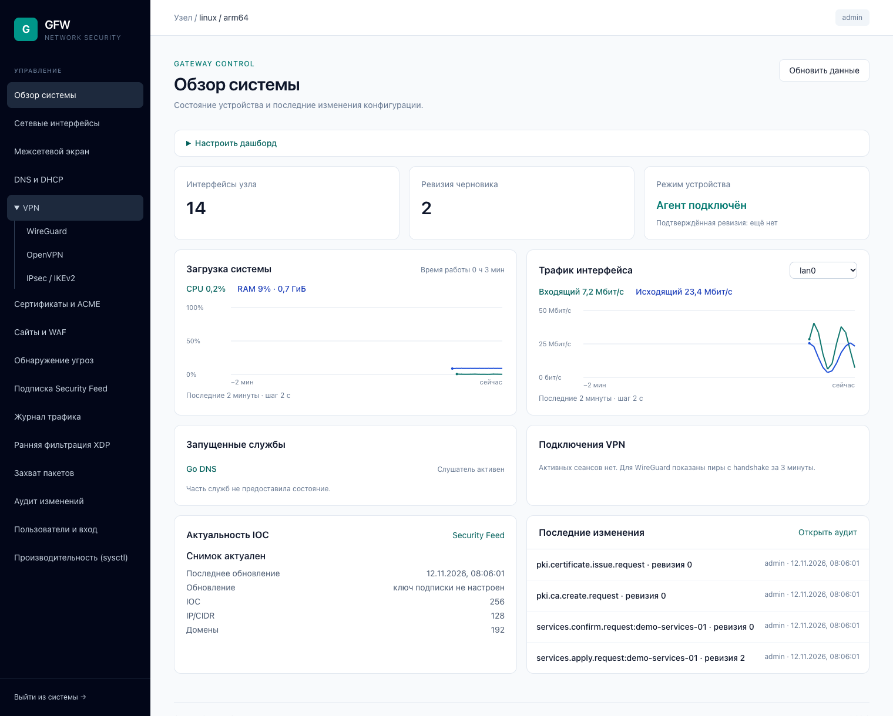

# GFW

Автор — Кислов Роман Сергеевич. [Apache License 2.0](LICENSE) · [Уведомления](NOTICE).

[Руководство администратора](docs/administrator.md) · [Руководство пользователя](docs/user.md)

Система управления NGFW на Go. Один RPM для ALT Linux p10/p11 или один DEB для Ubuntu 26.04 LTS на архитектуру. На ALT поддерживаются VLAN, bridge/bond, IP и маршруты через etcnet. На Ubuntu панель управляет выделенными интерфейсами через Netplan и systemd-networkd. Правила nftables, stateful, NAT, подтверждение и автооткат доступны через Linux-агент. Интерфейс Tailwind CSS встроен в Go-бинарник, внешние CDN не используются.

[Релизы на GitHub](https://github.com/rkislov/gfw/releases) · [Сборка и установка пакетов](docs/single-package.md).

Дашборд показывает загрузку CPU и памяти, трафик интерфейса, запущенные службы, VPN-сеансы и актуальность IOC. Виджеты можно скрывать и переставлять.



[Правила межсетевого экрана](docs/screenshots/firewall.png) · [Настройка захвата пакетов](docs/screenshots/packet-capture.png) · [Сертификаты и ACME](docs/screenshots/certificates.png). Скриншоты сделаны на изолированном тестовом узле с демонстрационными данными.

## Запуск

Нужен Go 1.27 или новее. Готовый CSS включён в проект; Node.js для запуска и обычной Go-сборки не требуется.

```sh
make build
./bin/gfwd -data-dir ./data
```

Откройте [панель GFW](http://127.0.0.1:8088). Для входа прочитайте созданный файл `data/admin.token` в терминале и введите ключ в форму. Сервис не печатает ключ в журнал. Каталог данных должен иметь права 0700, файл ключа — 0600. Смена ключа выполняется при остановленном сервере; после смены нужен перезапуск.

База SQLite `data/gfw.db` содержит черновик и административный аудит. Ревизия проверяется на каждом сохранении, конфигурация и событие аудита записываются одной транзакцией. После перезапуска данные сохраняются. Для сетевого журнала предусмотрен отдельный [экспорт в ClickHouse](docs/traffic.md).

По умолчанию HTTP слушает только loopback. Для удалённого HTTP-доступа используйте SSH-туннель. Прослушивание внешнего адреса требует `-tls-cert` и `-tls-key`.

## Отдельный агент

```sh
./bin/gfw-agent -socket ./data/agent.sock
```

В другом терминале:

```sh
./bin/gfwd -data-dir ./data -agent-socket ./data/agent.sock
```

Агент использует Unix-сокет 0600 в закрытом каталоге. Без `-enable-apply` обе службы можно запускать одним непривилегированным пользователем: агент только читает интерфейсы. Если указан сокет, недоступность агента возвращает ошибку; панель не подменяет данные интерфейсами контроллера. При аварийном завершении может остаться файл сокета: сначала убедитесь, что агент остановлен, затем удалите именно этот файл перед запуском.

## Управление политикой

- Вход по случайному 256-битному ключу, HttpOnly/SameSite-сессия, CSRF, ограничение попыток входа и отзыв сессии при выходе.
- Реальные интерфейсы узла: состояние UP, IPv4/IPv6, MTU, MAC; просмотр напрямую или через агент.
- Упорядоченные правила «К устройству», «Через устройство» и «От устройства»: CIDR, IPv4/IPv6, TCP/UDP/ICMP, порт назначения, accept/drop/reject, включение, перестановка и удаление.
- Строгая серверная валидация, UUID правил, защита от потерянных обновлений через ETag/If-Match, компиляция в отдельную таблицу `inet gfw`.
- Предпросмотр результата и последние 100 событий сохранения конфигурации.

## Управление сетью

В разделе интерфейсов доступны VLAN, bridge, bond (active-backup/LACP), статические IPv4/IPv6-адреса и маршруты. Linux-агент сохраняет конфигурацию через etcnet на ALT и Netplan на Ubuntu, ждёт подтверждения и откатывает файлы вместе с состоянием ядра. LAN и его зависимости защищены от удаления и перестройки. Сетевые изменения включаются флагом `-enable-network`; обновлённый systemd unit уже содержит его. [Инструкция по сети](docs/network-management.md).

## DNS, DHCP и единая установка

DNS и DHCP-ядра включены в `gfw-agent`; в панели доступны DNS с локальными зонами, кешем и ACL, DHCPv4-пулы, резервации, аренды и последние DNS-запросы. Настройки используют общую очередь подтверждения и отката с сетью и firewall. [Инструкция DNS/DHCP](docs/dns-dhcp.md).

`make rpm` собирает один пакет `gfw` для ALT p10 — с контроллером, агентом, встроенными сетевыми службами, интерфейсом и systemd. Отдельные gdns/godhcp не устанавливаются. [Сборка и установка единого пакета](docs/single-package.md).

## WireGuard VPN

Встроенный модуль ядра: туннели, peers/PSK, адреса и маршруты, зашифрованные ключи, экспорт клиента и handshake/RX/TX. Использует общую очередь подтверждения и отката; LAN защищён. [Инструкция WireGuard](docs/wireguard.md).

## Сертификаты

Встроенный менеджер CA/ACME: локальный CA, серверные/клиентские сертификаты с SAN/EKU, импорт PEM, отзыв/CRL, шифрование ключей и HTTP-01 с автопродлением. Сертификат панели меняется без перезапуска, с проверкой нового TLS-соединения, подтверждением и откатом. [Инструкция сертификатов](docs/certificates.md).

## Подписка Security Feed

В панели можно сохранить API-ключ feed.kislovs.ru, проверить доступ и обновить локальный снимок вручную или по расписанию. SQLite хранит исходные IP/CIDR, домены, каталог и IOC с происхождением, а также нормализованные IP и домены. Ключ хранится зашифрованным. Снимки доступны для скачивания из авторизованной панели. Можно закрепить IP/CIDR и домены за черновиками firewall и DNS с локальными исключениями. Применение и откат проходят через Linux-агент. [Инструкция Security Feed](docs/feed.md).

## Обнаружение угроз

Раздел «Обнаружение угроз» управляет Suricata в режимах IDS (AF_PACKET) и IPS (NFQUEUE). Интерфейсы, HOME_NET и локальные сигнатуры применяются через Linux-агент с проверкой, подтверждением и откатом. В IPS проверяются оба направления разрешённого транзита с выбранной политикой отказа. Алерты EVE сохраняются в отдельной SQLite-базе агента. Файлы можно вручную сверить с файловыми IOC из подписки. Suricata регистрирует совпадения в открытом HTTP-трафике. [Настройка IDS](docs/ids.md).

## Сайты и WAF

FESS публикует HTTP(S) upstream по домену и префиксу пути. Панель управляет сертификатами сайтов, локальными правилами, импортом WAF из Security Feed и журналом. [Настройка FESS](docs/fess.md).

## Границы текущей сборки

Linux-агент с `-enable-apply` проверяет правила через `nft -c`, атомарно заменяет собственную таблицу и ждёт подтверждения 30–600 секунд. При тайм-ауте, остановке или перезапуске неподтверждённые изменения откатываются; подтверждённые восстанавливаются при запуске. Обязательное anti-lockout-правило сохраняет вход и ответы панели через заданный LAN-интерфейс. [Установка на ALT p10, systemd и протокол восстановления](docs/linux-agent.md).

В интерфейсе направления обозначены «К устройству», «Через устройство» и «От устройства». В техническом API сохранены input/forward/output. Базовая политика к устройству и между сетями — запрет; stateful-фильтрация включается в панели. Зоны LAN/WAN/DMZ/VPN, группы IP/сервисов и IPv4 NAT с hairpin доступны в [инструкции firewall](docs/firewall-management.md).

OpenVPN и IPsec находятся в разделе VPN. [OpenVPN](docs/openvpn.md), [IPsec](docs/ipsec.md). Разрешённый транзит TCP/UDP можно выборочно ускорять через nftables. [Ускорение транзита](docs/flowtable.md). Журнал трафика собирает conntrack и NFLOG, отправляет события в ClickHouse и поддерживает поиск в панели. Ранняя фильтрация блокирует IP/CIDR и сетевые индикаторы подписки на WAN. [Ранняя фильтрация XDP](docs/xdp.md). Захват через XDP и AF_PACKET сохраняет PCAP с фильтрами из панели. [Захват пакетов](docs/capture.md). [Журнал трафика](docs/traffic.md). Go-бинарники собираются для Linux, с изолированным стендом проверки nftables на userspace ALT p10. Просмотр интерфейсов работает также на macOS для локальной разработки.

## Frontend и проверки

```sh
npm ci
npm run build:css
make test
make check
```

Tailwind CSS закреплён в `package-lock.json`; готовый `internal/web/assets/app.css` включается в бинарник через `go:embed`. При изменении классов пересоберите CSS до Go-сборки.

API использует `/api/v1`: `auth/login`, `auth/me`, `auth/logout`, `status`, `interfaces`, `config`, `changes/plan`, `changes/state`, `changes/apply`, `changes/{id}/confirm`, `changes/{id}/rollback`, `audit`. Cookie-клиент передаёт CSRF из `auth/me` в `X-GFW-CSRF` для изменяющих запросов; интеграционный клиент может использовать административный `Authorization: Bearer`. `PUT config` требует `If-Match` из последнего GET. Не передавайте ключ в query string.

### IPsec / IKEv2

В меню VPN доступны туннели IPsec между IPv4-шлюзами на strongSwan, сертификаты локального CA, XFRM-маршруты, состояние SA, журналы, подтверждение и откат. [Настройка IPsec](docs/ipsec.md).

### OpenVPN: сервер, клиент и профили

Управление экземплярами через Linux-агент: IPv4 TUN, локальный CA, UDP/TCP, допуск клиентов по сертификатам, постоянные адреса, явные маршруты клиента, состояние и журналы. Общая транзакция подтверждения/отката и anti-lockout на LAN. CRL доставляется при отзыве и фоновым циклом; номер CRL не понижается при откате. Всё входит в единый RPM. [Инструкция и ограничения](docs/openvpn.md).
